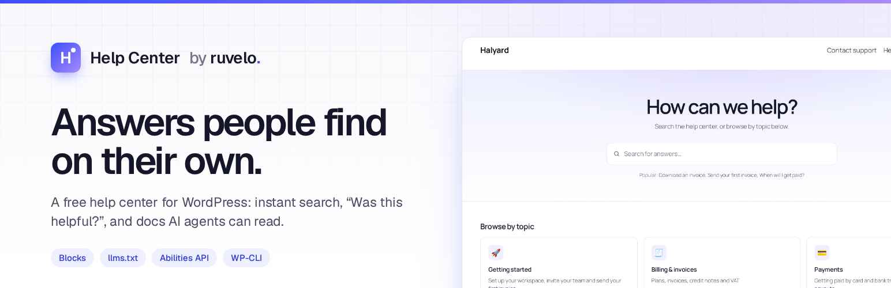
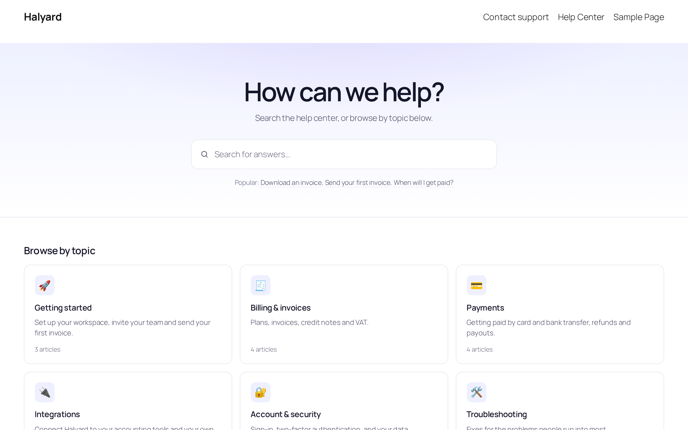
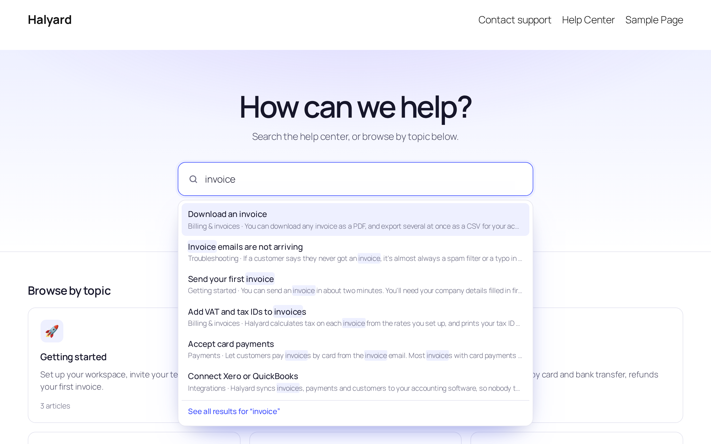
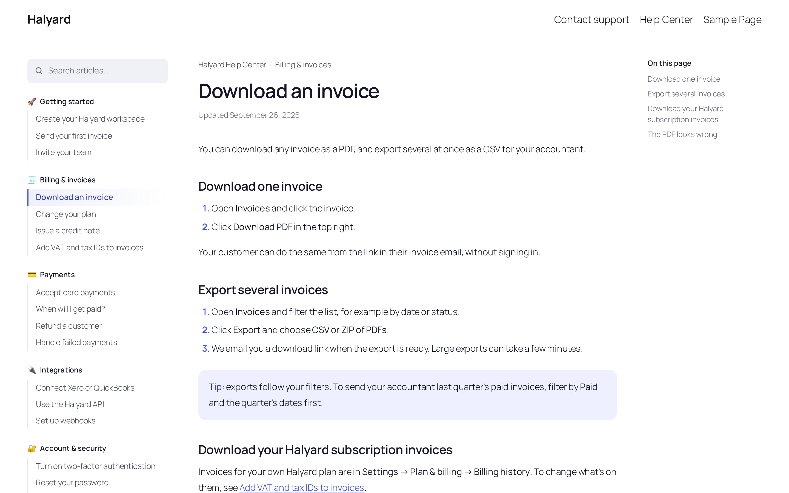
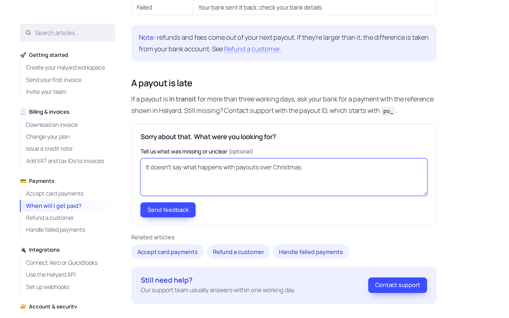
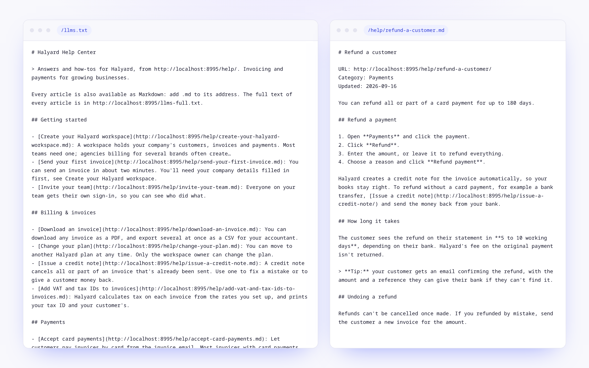
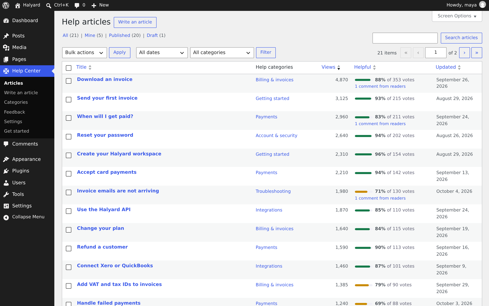
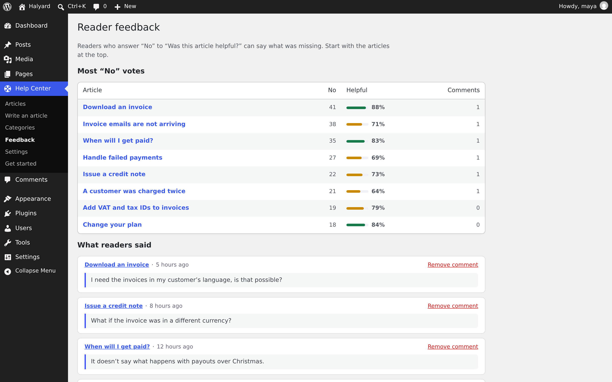
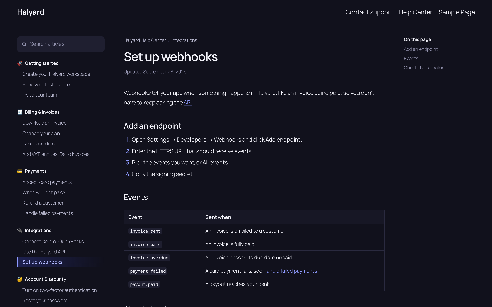
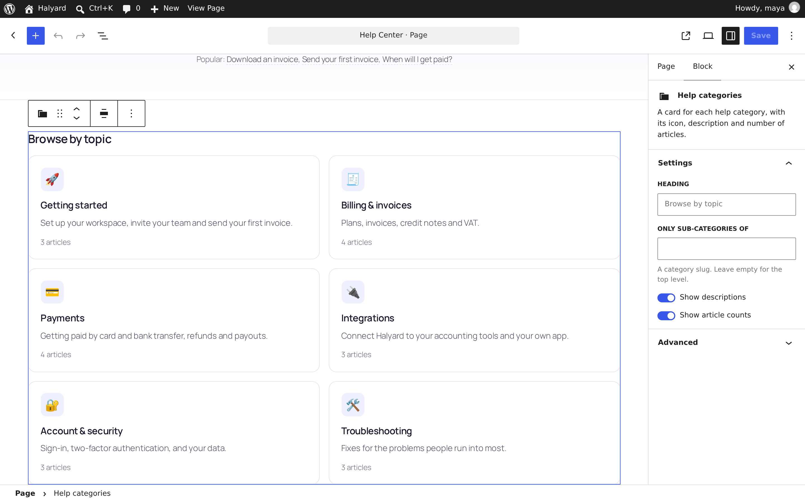

<p align="center">
  <a href="https://ruvelo.github.io/wp-help-center/"></a>
</p>

<p align="center">
  <a href="https://playground.wordpress.net/?blueprint-url=https://raw.githubusercontent.com/Ruvelo/wp-help-center/main/blueprint.json"><strong>Try it live</strong></a> &nbsp;&nbsp;&nbsp;
  <a href="#use-it-from-ai-agents"><strong>AI agents</strong></a> &nbsp;&nbsp;&nbsp;
  <a href="#for-developers"><strong>Developer guide</strong></a> &nbsp;&nbsp;&nbsp;
  <a href="CHANGELOG.md"><strong>Changelog</strong></a>
</p>

<p align="center">
  <a href="https://github.com/Ruvelo/wp-help-center/actions/workflows/tests.yml"></a>
  
  
  
  
  <a href="LICENSE"></a>
</p>

# Ruvelo Help Center

**A free help center for WordPress, ready for AI agents.** Articles in categories, instant search, "Was this helpful?", docs-style pages, and Markdown, `llms.txt` and abilities so AI agents can read it too. No pro version, no upsells, no tracking.

```
wp plugin install https://github.com/Ruvelo/wp-help-center/releases/latest/download/ruvelo-help-center.zip --activate
wp help-center setup
```

Then open `/help/` and write the first article, or import a folder of Markdown. Or [try it in WordPress Playground](https://playground.wordpress.net/?blueprint-url=https://raw.githubusercontent.com/Ruvelo/wp-help-center/main/blueprint.json) first, with the Halyard demo help center.

It's the WordPress sibling of [ruvelo/laravel-help-center](https://github.com/Ruvelo/laravel-help-center).

## A quick tour



**Customers start with a question.** The home page is a search box, a card for each topic and the articles people read most. It's an ordinary page made of blocks, so you can change it like any other.



**Answers appear as they type.** Suggestions come from titles and article text, with the matching words highlighted, and work with the keyboard and screen readers. Press Enter for all results; an exact title goes straight to the article. Without JavaScript it's a normal search form.



**Articles read like good docs.** Categories and their articles on the left, the article in the middle, its outline on the right. Underneath: "Was this article helpful?", related articles and a "Still need help?" box.

<table>
  <tr>
    <td width="50%"></td>
    <td width="50%"></td>
  </tr>
  <tr>
    <td><strong>Hear what's missing:</strong> after a "No", readers can say why. No cookies, one vote each.</td>
    <td><strong>Readable by AI agents:</strong> every article as Markdown, and an <code>llms.txt</code> map.</td>
  </tr>
  <tr>
    <td width="50%"></td>
    <td width="50%"></td>
  </tr>
  <tr>
    <td><strong>See what works:</strong> views and the helpful share, sortable, in the article list.</td>
    <td><strong>Fix the worst first:</strong> the articles with the most "No" votes, and every comment.</td>
  </tr>
  <tr>
    <td width="50%"></td>
    <td width="50%"></td>
  </tr>
  <tr>
    <td><strong>Light and dark</strong>, following each reader's system setting.</td>
    <td><strong>All blocks:</strong> every part of the help center is a block you can place and set up.</td>
  </tr>
</table>

## Features

- **Content that's plain WordPress**: an Article post type with a hierarchical Category taxonomy. Categories have an emoji icon, a description and a position; articles have a position, an excerpt, revisions and drafts. Articles live at `/help/{slug}/`, categories at `/help/category/{slug}/`.
- **Search that helps**: suggestions as you type over REST, debounced and cancellable, every word matched across titles, excerpts and text (never block markup), titles ranked first, highlighted snippets, and an exact title jumps straight to the article.
- **Docs-style articles**: the help menu with the current article marked, breadcrumbs, an "Updated" date and an "On this page" outline that follows your reading.
- **"Was this article helpful?"** One vote per reader without cookies, an optional comment after a "No", a honeypot and a rate limit. Votes live in a table of their own with a unique index.
- **Links between articles**: `[[Download an invoice]]`, `[[Download an invoice|this guide]]` or `[[Refunds#Timing]]`. Readers never hit a dead end; editors see missing ones in red, linking to "Write an article".
- **Related articles** an editor picks, or neighbours in the same category, and a **"Still need help?"** box pointing to your contact page or email.
- **13 dynamic blocks** rendered in PHP, styled with CSS variables, in light and dark: Help search, Help categories, Popular help articles, Contextual help, Still need help?, Was this helpful?, On this page, Help menu, Help breadcrumbs, Help article details, Related help articles, Help category header and Help search results.
- **Block templates** for block themes (editable in the Site Editor; a theme file of the same name wins) and the same layout on classic themes, plus shortcodes.
- **For AI agents**: Markdown for every article, `llms.txt` and `llms-full.txt`, abilities for the WordPress Abilities API, and an MCP server when the MCP Adapter is active.
- **An admin that tells you something**: views and helpful share in the article list, a feedback screen, a "How it's doing" box in the editor, and a get-started screen that creates the home page.
- **WP-CLI** for everything: import and export Markdown folders (round trip), set-up, settings, search, stats and feedback.
- **SEO basics**: meta descriptions from excerpts (unless an SEO plugin is active), `noindex` on searches and drafts, canonical URLs and sitemaps from core.

## Our promises

- **No nags, ads, upsells, review requests or "pro" teasers.** Nothing outside the plugin's own screens, no redirect on activation.
- **No tracking and no remote requests.** No telemetry; no fonts, scripts or images from anywhere.
- **Distributed only through WordPress.org and Composer**, updated by WordPress's own updater. Never sold.
- **Your content stays yours.** Deleting the plugin keeps everything unless you turn on "Delete everything when the plugin is deleted". No cron jobs, nothing left behind.
- **Accessible**: WCAG 2.2 AA in mind, works without JavaScript, respects reduced motion and dark mode.

## Requirements

- WordPress 7.0 or later (tested up to 7.1)
- PHP 8.2 or later
- Optional: the [MCP Adapter](https://github.com/WordPress/mcp-adapter) plugin, for the MCP server

## Install

From WordPress: download [ruvelo-help-center.zip](https://github.com/Ruvelo/wp-help-center/releases/latest/download/ruvelo-help-center.zip), then **Plugins → Add New → Upload Plugin**. A WordPress.org listing is on its way. Or with Composer, on a [Composer-managed site](https://roots.io/bedrock/):

```
composer require ruvelo/wp-help-center
```

Then **Help Center → Get started → Create the home page** (or `wp help-center setup`), and add a contact page or email under **Help Center → Settings**.

## Settings

**Help Center → Settings**, or `wp help-center settings set <key> <value>`, or in code with the `ruvelo_help_center_settings` filter (it wins over the screen):

| Key | Default | |
|---|---|---|
| `base` | `help` | The address: `/help/`, `/help/{article}/`, `/help/category/{category}/` |
| `title` | `Help Center` | Shown in breadcrumbs, page titles and `llms.txt` |
| `headline` / `intro` | `How can we help?` / one line | The home page hero |
| `popular` | `6` | Popular articles on the home page; `0` hides them |
| `contact_url` / `contact_email` | empty | Where "Still need help?" sends people; with neither, the box is hidden |
| `contact_label` / `contact_text` | `Contact us` / one line | The box's button and text |
| `drafts` | `editors` | Who sees drafts on the help center: `editors` (people who can write posts) or `members` (any signed-in user) |
| `appearance` | `auto` | `auto` follows each reader's light or dark setting; `light` or `dark` |
| `markdown` | `true` | Serve articles as Markdown at `.md` |
| `llms` / `llms_root` | `true` / `true` | Publish `llms.txt`; also at the site root |
| `agent_drafts` | `false` | Register the `save-draft` ability |
| `mcp_server` | `true` | Create the help center MCP server when the MCP Adapter is active |
| `count_views` | `true` | Count article views |
| `delete_data` | `false` | Delete everything when the plugin is deleted |

```php
add_filter('ruvelo_help_center_settings', function (array $settings): array {
    $settings['contact_email'] = 'support@example.com';
    $settings['appearance'] = 'light';

    return $settings;
});
```

## Use it from AI agents

WordPress decided in 2026 not to build a knowledge store for AI agents into core and to leave it to plugins. This plugin makes your help center one, with nothing to configure.

**Markdown and llms.txt.** Every published article is Markdown at its address plus `.md` (or `?format=md`), with its URL, category and date on top and `[[links]]` turned into ordinary links. [`/llms.txt`](https://llmstxt.org) lists the articles by category, and `/llms-full.txt` holds them all. Article pages point to their Markdown with `<link rel="alternate" type="text/markdown">`.

**Abilities.** The plugin registers these with the [Abilities API](https://developer.wordpress.org/apis/abilities/), in the `ruvelo-help-center` category:

| Ability | Input | Returns |
|---|---|---|
| `ruvelo-help-center/search-articles` | `query`, optional `category` and `limit` (up to 20) | `total` and `results`: `title`, `slug`, `url`, `markdown_url`, `excerpt`, `category`, best first |
| `ruvelo-help-center/get-article` | `article`: slug, ID or exact title | The article as `markdown`, with `title`, `url`, `category` and `updated` |
| `ruvelo-help-center/list-categories` | optional `with_articles` | Every category with `slug`, `name`, `icon`, `description`, `url` and `article_count` |
| `ruvelo-help-center/save-draft` | `title`, `markdown`, optional `category`, `excerpt`, `slug` | Off until you turn on "Let AI agents draft articles". Creates a draft, or updates a draft by `slug`; never publishes |

The three reads are public, because a public help center has nothing to hide, and they only ever return what the caller could read on the site: drafts only for people allowed to see them. `save-draft` checks that the caller is a help center editor on every call. Read-only abilities run over REST with `GET /wp-json/wp-abilities/v1/abilities/ruvelo-help-center/search-articles/run?input[query]=refund`.

**MCP.** Install the [MCP Adapter](https://github.com/WordPress/mcp-adapter) and the help center gets its own MCP server at `/wp-json/ruvelo-help-center/mcp`, with the abilities as tools. They're also available through the adapter's default server. Sign in with an [application password](https://make.wordpress.org/core/2020/11/05/application-passwords-integration-guide/):

```bash
claude mcp add --transport http help https://example.com/wp-json/ruvelo-help-center/mcp \
  --header "Authorization: Basic $(printf 'maya:xxxx xxxx xxxx xxxx xxxx xxxx' | base64)"
```

For a customer-facing chatbot, give it an account that can only read, and leave drafting off.

## For developers

### Hooks

| Hook | Type | |
|---|---|---|
| `ruvelo_help_center_settings` | filter | Every setting, saved values merged over the defaults |
| `ruvelo_help_center_feedback_received` | action | `($article_id, $helpful, $comment)` after a vote, and again when a comment follows |
| `ruvelo_help_center_agent_draft_saved` | action | `($post_id, $created)` after an AI agent saves a draft |
| `ruvelo_help_center_related_articles` | filter | `(WP_Post[] $posts, WP_Post $article)` the related articles |
| `ruvelo_help_center_article_markdown` | filter | `(string $markdown, WP_Post $article)` the Markdown served to readers and agents |
| `ruvelo_help_center_llms_txt` / `ruvelo_help_center_llms_full_txt` | filter | The two files |
| `ruvelo_help_center_meta_description` | filter | A page's meta description; `''` for none |
| `ruvelo_help_center_seo_plugin_active` | filter | Whether another plugin handles descriptions |
| `ruvelo_help_center_count_view` | filter | `(bool $count, WP_Post $article)` whether a read counts as a view |
| `ruvelo_help_center_rate_limit` | filter | `(int $per_minute, string $action)` votes per reader per minute (20) |
| `ruvelo_help_center_visitor_source` | filter | `(string $source, int $user_id)` what a guest's vote identity is hashed from, e.g. a forwarded IP behind a proxy |
| `ruvelo_help_center_mcp_permission` | filter | A transport permission callback for the MCP server (default: signed-in users) |
| `ruvelo_help_center_classic_template` | filter | `(string $file, string $kind)` the template used on classic themes |

### REST API

Articles and categories are core routes: `/wp/v2/help-articles` and `/wp/v2/help-categories` (with `ruvelo_icon` and `ruvelo_order` term meta). The plugin adds, under `/wp-json/ruvelo-help-center/v1`:

| Request | Who | Does |
|---|---|---|
| `GET /search?q=&category=&per_page=&page=` | anyone | Matches with `title_html` and `snippet_html` (escaped, matches in `<mark>`), `category`, `url`, `markdown_url` and `all_url` |
| `POST /articles/{id}/feedback` | anyone | `helpful` (`1`/`0`), or a `comment` after a "No". Returns `{"state": "yes" \| "no" \| "done"}`; `429` when rate limited |
| `GET /articles/{id}/markdown` | anyone who can read it | The article as Markdown |
| `GET /articles/{id}/stats` | people who can edit it | `views`, `yes`, `no`, `share` and recent comments |
| `GET /feedback?article=&per_page=&page=` | help center managers | Recent comments after "No" votes |

### WP-CLI

```bash
wp help-center import ./docs/help --status=published   # folders are categories; --dry-run shows what would change
wp help-center export ./docs/help                      # the same layout, back out
wp help-center setup                                   # create the home page
wp help-center settings list                           # or: get <key>, set <key> <value>
wp help-center search "refund"
wp help-center stats --format=csv
wp help-center feedback --article=download-an-invoice
wp help-center llms [--full]
```

Each sub-folder is a category; an optional `_category.md` sets `name`, `icon` and `position` in front matter, and the description as its body. Articles take `title`, `slug`, `status`, `position`, `excerpt`, `category` and `related` (slugs) from front matter, or the title from a leading `# Heading` or the file name. Articles are matched by slug and only saved when something changed. An export imports back unchanged.

```markdown
---
title: Download an invoice
slug: download-an-invoice
status: published
position: 1
related: [issue-a-credit-note]
---

You can download any invoice as a PDF…
```

### Blocks and shortcodes

All blocks are `ruvelo/help-*` and dynamic. On classic themes and page builders: `[ruvelo_help_home]`, `[ruvelo_help_search variant="compact"]`, `[ruvelo_help_categories]`, `[ruvelo_help_popular count="4"]`, `[ruvelo_help_articles category="billing-invoices" limit="5"]` (or `search="refund"`) and `[ruvelo_help_contact]`.

Every class starts with `ruvelo-hc`, and every colour is a variable on `.ruvelo-hc`: override `--ruvelo-hc-accent`, `--ruvelo-hc-bg`, `--ruvelo-hc-ink` and friends in your theme.

### Capabilities and data

- `ruvelo_manage_help_center` (administrators and editors) runs the feedback and settings screens. Writing articles uses the usual post capabilities.
- Votes are in `{prefix}ruvelo_help_feedback`; views and vote counts are copied to post meta (`_ruvelo_views`, `_ruvelo_helpful_yes`, `_ruvelo_helpful_no`, `_ruvelo_helpful_share`) for sorting.
- Search reads a plain-text copy of each article kept in `post_content_filtered`, so block markup never matches.

## Contributing

Pull requests are welcome. Clone, `composer install`, set up the local site in [CONTRIBUTING.md](CONTRIBUTING.md), then `composer check` runs Pint, PHPCS (WordPress security, database and i18n rules), PHPStan level 8 and the integration tests, as CI does. See the [changelog](CHANGELOG.md).

## Credits

Built by [François Bultez](https://github.com/francoisbultez) at [Valtry](https://valtry.co.uk/?utm_source=ruvelo&utm_medium=github&utm_campaign=wp-help-center), the website security scanner, and everyone who [contributes](https://github.com/Ruvelo/wp-help-center/graphs/contributors). The Halyard demo content is shared with [laravel-help-center](https://github.com/Ruvelo/laravel-help-center).

## License

GPL-2.0-or-later. See [LICENSE](LICENSE).
